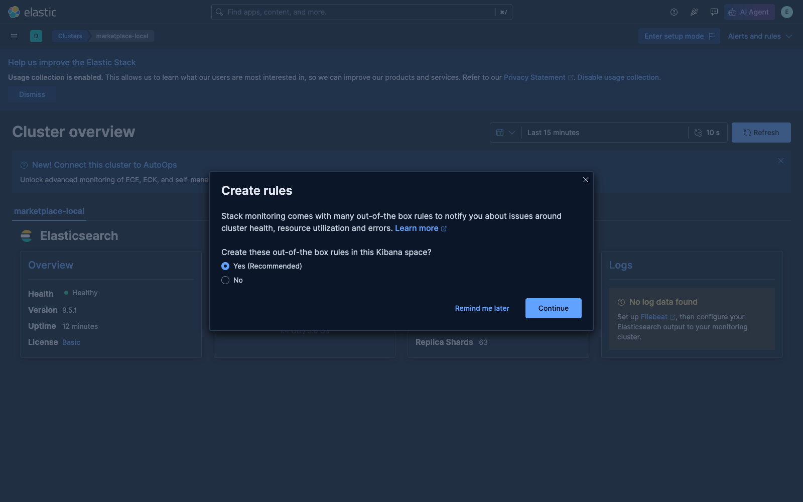
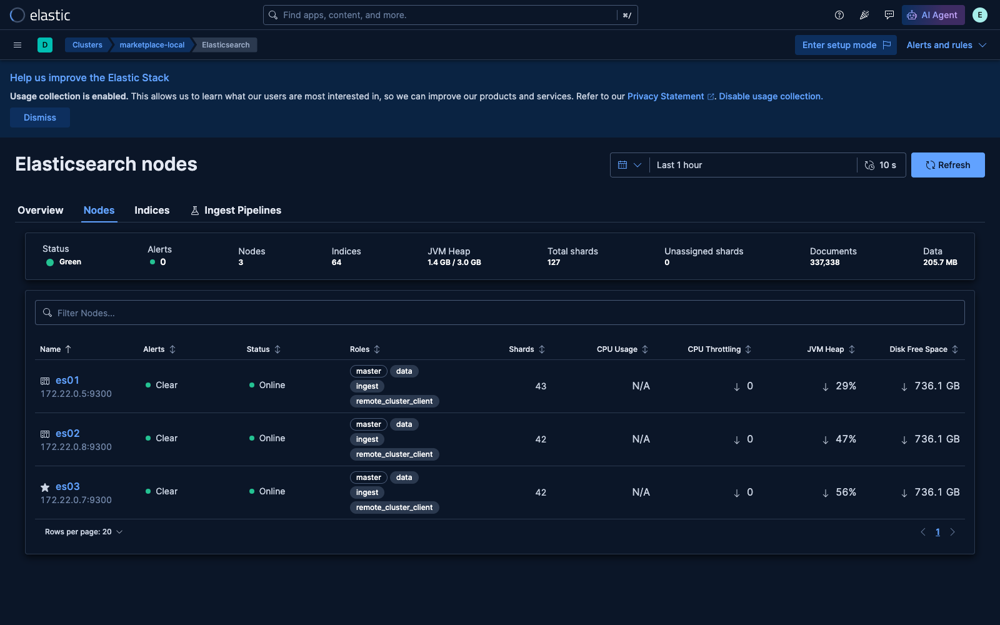
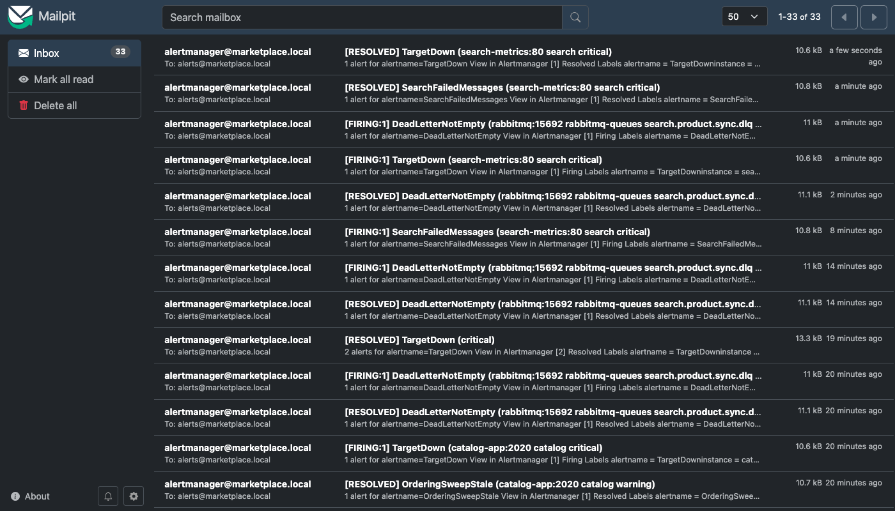
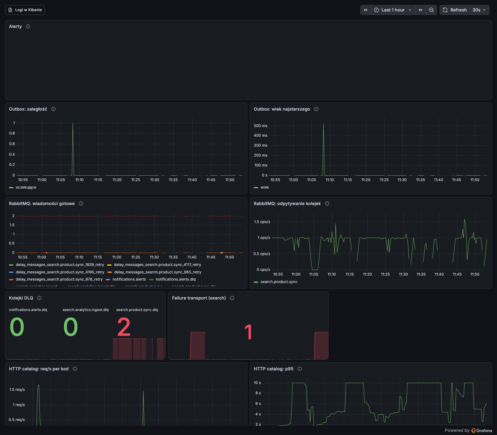
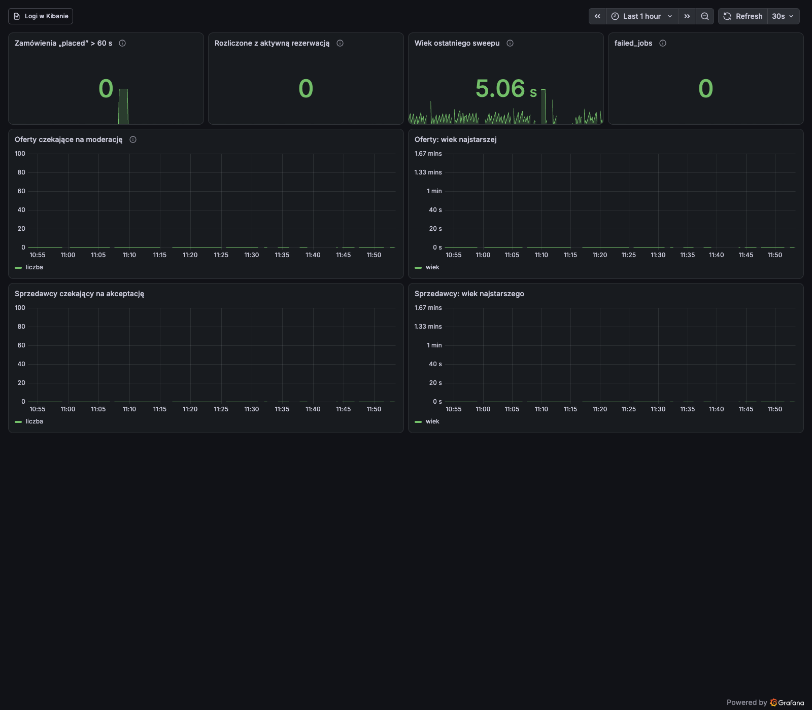
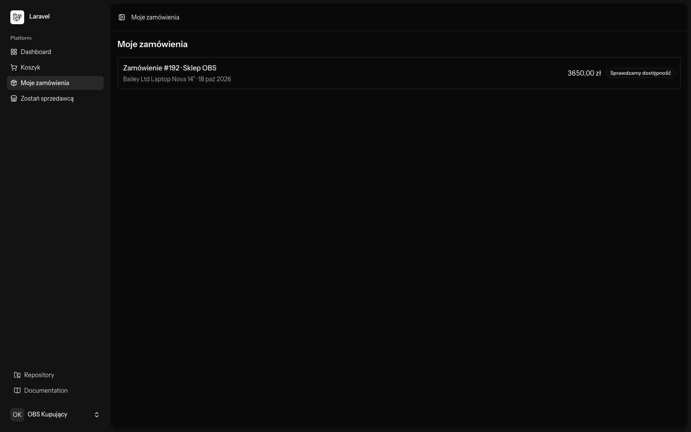
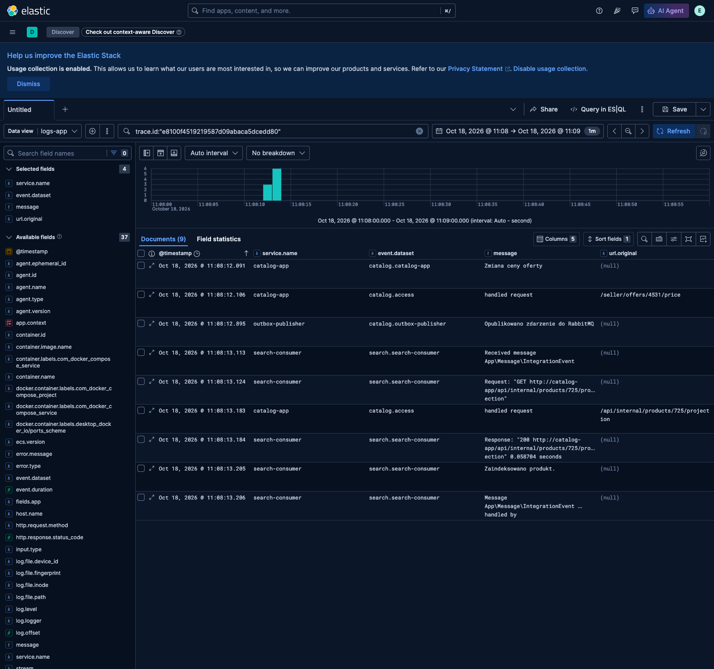

# Observability: logi w Elasticsearchu, metryki i alerty w Prometheusie, krok po kroku

*ETAP 11 projektu Marketplace Search Platform. Do tej pory, gdy coś się
psuło, odpowiedź brała się z `docker logs` i z pytania „czy ktoś to
zauważył?”. Ten etap buduje dwie rzeczy, które to zastępują: **logi
aplikacji w Elasticsearchu**, połączone jednym `trace_id` od kliknięcia
w przeglądarce do zapisu w indeksie, oraz **metryki i alerty
w Prometheusie**, które same piszą maila, gdy konsument stanie, outbox
zatnie się albo zamówienie utknie. Przy okazji: ingest pipeline, data
streams, ILM na żywo, ECS, PromQL, testy jednostkowe reguł alertów
i gauge liczone przy scrape jako sposób na metryki z PHP.*

> **Stan:** gałąź `observability` (commity `4de3f0a..` z prefiksem
> `ETAP 11`), **niewypchnięta i niezmergowana**. Testy na hoście zielone
> (catalog 800 testów: 785 zielonych, 15 pominiętych; search
> `tests/Unit` 18 testów), `make obs-check` zielone (14 reguł, 41 testów
> `promtool`). **DoD sprawdzone na żywym stacku 2026-10-18** (godziny w UTC):
> `SearchConsumerDown` po zatrzymaniu konsumenta `firing` po 2:01, mail po
> 2:08, `RESOLVED` 21 s po starcie; `OrdersStuckPlaced` z zatrzymanym
> workerem; jedna zmiana ceny = 9 dokumentów z tym samym `trace.id`
> w Kibanie; ILM demo hot → warm → delete; Stack Monitoring z 3 węzłami;
> narzut RAM profilu `obs` ~450–600 MiB
> ([POMIARY, sekcja 12](../POMIARY.md#12-observability-etap-11-2026-10-18)).
> Weryfikacja szła z kontenerami aplikacji przełączonymi na kod z worktree;
> po niej główny checkout wrócił na `main`, więc **do merge'a** targety
> `catalog`, `caddy` i `search` w Prometheusie są DOWN (RUNBOOK
> [#062](../RUNBOOK.md#062)). Nie zrobione: wdrożenie na VPS/k3s,
> `promphp` w search i eksportery (kolejny PR). **Otwarte:** węzły ES
> restartowały się w czasie weryfikacji na przepełnionej maszynie
> (RUNBOOK [#058](../RUNBOOK.md#058)) — decyzja o pamięci ES czeka.
>
> Decyzja: [ADR-0005](../adr/0005-metryki-w-prometheusie-logi-w-es.md).
> Spec: [`superpowers/specs/2026-10-17-observability-design.md`](../superpowers/specs/2026-10-17-observability-design.md)
> (poprawiony do kodu po implementacji), plan:
> [`superpowers/plans/2026-10-17-observability.md`](../superpowers/plans/2026-10-17-observability.md).
> Błędy: RUNBOOK [#051–#066](../RUNBOOK.md#051).

---

## Spis treści

1. [Dlaczego ten etap i dlaczego dwa systemy](#1-dlaczego-ten-etap-i-dlaczego-dwa-systemy)
2. [Mapa: co powstało i gdzie](#2-mapa-co-powstało-i-gdzie)
3. [Jak czytać ten przewodnik i odtwarzać kroki](#3-jak-czytać-ten-przewodnik-i-odtwarzać-kroki)
4. [Krok 1 — `trace_id` w catalog: middleware i Context](#krok-1--trace_id-w-catalog-middleware-i-context)
5. [Krok 2 — `trace_id` w outboxie i nagłówku AMQP](#krok-2--trace_id-w-outboxie-i-nagłówku-amqp)
6. [Krok 3 — `trace_id` w search i z powrotem do catalog](#krok-3--trace_id-w-search-i-z-powrotem-do-catalog)
7. [Krok 4 — logi JSON na stderr](#krok-4--logi-json-na-stderr)
8. [Krok 5 — Elasticsearch: szablony, data streams, pipeline ECS](#krok-5--elasticsearch-szablony-data-streams-pipeline-ecs)
9. [Krok 6 — Filebeat](#krok-6--filebeat)
10. [Krok 7 — ILM i demo na żywo](#krok-7--ilm-i-demo-na-żywo)
11. [Krok 8 — Stack Monitoring (Metricbeat)](#krok-8--stack-monitoring-metricbeat)
12. [Krok 9 — Metryki catalog: gauge liczone przy scrape](#krok-9--metryki-catalog-gauge-liczone-przy-scrape)
13. [Krok 10 — `search-metrics`](#krok-10--search-metrics)
14. [Krok 11 — Caddy `:2020` i historia o nagłówku `Host`](#krok-11--caddy-2020-i-historia-o-nagłówku-host)
15. [Krok 12 — Reguły alertów i ich testy](#krok-12--reguły-alertów-i-ich-testy)
16. [Krok 13 — Alertmanager → mailpit i Grafana](#krok-13--alertmanager--mailpit-i-grafana)
17. [Krok 14 — Jak uruchomić](#krok-14--jak-uruchomić)
18. [Krok 15 — Weryfikacja na żywym stacku (DoD)](#krok-15--weryfikacja-na-żywym-stacku-dod)
19. [Wszystko, co się zepsuło](#wszystko-co-się-zepsuło)
20. [Lista ręcznej weryfikacji](#lista-ręcznej-weryfikacji)
21. [Świadomie poza zakresem i znane ograniczenia](#świadomie-poza-zakresem-i-znane-ograniczenia)
22. [Bilans](#bilans)
23. [Ściąga](#ściąga)
24. [Twoja kolej](#twoja-kolej)

---

## 1. Dlaczego ten etap i dlaczego dwa systemy

Ten system ma kilka miejsc, gdzie praca może cicho stanąć: outbox bez
publishera (RUNBOOK [#031](../RUNBOOK.md#031)), konsument search, który po
restarcie ES odrzuca wszystko do failure transportu (#050), saga zamówień,
której worker nie działa (#045), sweep, który ginie od OOM (#048). Każdy
z tych incydentów znalazł człowiek, który akurat patrzył. Cel etapu:
**system ma powiedzieć sam**, a gdy powie, ma dać się prześledzić jedno
konkretne żądanie przez wszystkie serwisy.

Pierwotny plan wkładał wszystko do ES: logi przez Filebeat, metryki przez
Metricbeat. [ADR-0005](../adr/0005-metryki-w-prometheusie-logi-w-es.md)
to zmienił, bo dokumentacja projektu przeczyła sama sobie (dokument `04`
odradza ES do metryk z alertami), a fakty były takie:

- najważniejsze sygnały to **liczby w czasie** (zaległość outboxu, głębokość
  kolejki, wiek najstarszego zamówienia `placed`), a do nich potrzebne są
  alerty, nie przeglądanie dokumentów;
- na licencji basic Kibana **nie wyśle maila** z alertu;
- RabbitMQ i Caddy już wystawiają metryki w formacie Prometheusa;
- PHP nie współdzieli pamięci między procesami, więc licznik w pamięci nie
  ma sensu (o tym w kroku 9).

Podział:

| Sygnał | Gdzie | Gdzie oglądać |
|---|---|---|
| Logi aplikacji (ECS, `trace.id`) | ES, data streams `logs-app-*` + ILM | Kibana → Discover |
| Metryki samego klastra ES | ES, przez Metricbeat | Kibana → Stack Monitoring |
| Pozostałe metryki i **wszystkie** alerty | Prometheus | Grafana, Alertmanager → mailpit |

Koszt jest uczciwy: dwa systemy, dwa UI. Most między nimi to czas
i `trace_id`: w Grafanie jest przycisk „Logi w Kibanie” z tym samym
zakresem czasu, a access log ma `trace.id`, po którym łączy się wszystko
inne.

---

## 2. Mapa: co powstało i gdzie

```
apps/catalog/app/Support/Tracing/TraceId.php        trace_id: current(), generate(), traceparent in/out
apps/catalog/app/Http/Middleware/AssignTraceId.php  globalny middleware: Context + nagłówek X-Trace-Id
apps/catalog/app/Support/Outbox/OutboxMessageFactory.php   koperta + nagłówek AMQP trace_id
apps/catalog/database/migrations/…add_trace_id_to_outbox_table.php   outbox.trace_id char(32) null
apps/catalog/app/Metrics/CatalogGauges.php          10 gauge liczonych SQL-em przy scrape
apps/catalog/app/Providers/PrometheusServiceProvider.php   rejestracja w spatie/laravel-prometheus
apps/search/src/Messenger/TraceIdStamp.php          ślad jako stamp Messengera
apps/search/src/Tracing/{TraceContext,TraceContextSubscriber,TraceIdLogProcessor}.php
apps/search/src/Service/CatalogProjectionClient.php  + traceparent do catalog
apps/search/src/Controller/MetricsController.php     GET /metrics (failure transport)
apps/search/config/packages/monolog.yaml             handler stderr_json (JSON na stderr)
infra/caddy/Caddyfile                                metrics { per_host }, blok http://:2020, access log wewnętrzny
infra/obs/elasticsearch/                             obs-setup: komponenty, szablony, pipeline, ILM, rola, próbki
infra/obs/filebeat/filebeat.yml                      autodiscover, filestream, tylko JSON z marketplace
infra/obs/metricbeat/metricbeat.yml                  moduł elasticsearch, xpack, co 30 s
infra/obs/prometheus/{prometheus.yml,rules/}         7 jobów, 14 reguł + 41 testów promtool
infra/obs/alertmanager/alertmanager.yml              jedna trasa → mailpit
infra/obs/grafana/{provisioning,dashboards}/         źródła danych i 2 dashboardy z repo
compose.yaml                                         profil obs (8 kontenerów), x-json-logging, LOG_* w catalog
Makefile                                             up-obs, obs-check, urls
```

Razem: 68 plików w `apps/`, `infra/` i `compose.yaml`, +4157 linii
(`git diff --stat 1393b27..HEAD`, sporo z tego to JSON dashboardów
i testy).

Droga jednej zmiany ceny i droga sygnałów:

```
przeglądarka ──PUT /seller/offers/{id}/price──► catalog-app (Caddy + Laravel)
   ◄── X-Trace-Id: e8100f45…                    │ AssignTraceId: Context[trace_id]
                                                │ Log::info „Zmiana ceny oferty”   ──┐
                                                │ outbox.trace_id                      │
outbox-publisher ── AMQP header trace_id ──► RabbitMQ                                  │ stderr JSON
                                                │ basic.get                            │ (json-file)
search-consumer ◄───────────────────────────────┘ TraceIdStamp → TraceContext          │
   │ GET /api/internal/products/{id}/projection  traceparent: 00-e8100f45…-…-01        ▼
   └──────────────► catalog-app (http://catalog-app) ─ access log z X-Trace-Id ──► Filebeat
   │ zapis do products-search, log „Zaindeksowano produkt.”  ─────────────────────► │
                                                                                     ▼
                                          ES: pipeline logs-app (ECS) → logs-app-catalog / logs-app-search
                                                                                     ▼
                                                                Kibana Discover: trace.id: e8100f45…

Prometheus (co 15 s) ◄── rabbitmq:15692 (/metrics, /metrics/detailed)
                     ◄── catalog-app:2020/metrics      (Caddy: caddy_http_*)
                     ◄── catalog-app:2020/prometheus   (gauge catalog_*)
                     ◄── search-metrics:80/metrics     (search_messenger_failed_messages)
        │ 14 reguł ──► Alertmanager ──SMTP──► mailpit        Grafana ──► Prometheus, Alertmanager
Metricbeat (co 30 s) ──► es01 ──► .monitoring-es-* ──► Kibana Stack Monitoring
```

---

## 3. Jak czytać ten przewodnik i odtwarzać kroki

Każdy krok to jeden albo dwa Taski planu. Commity w kolejności:

```bash
git log --oneline --reverse 1393b27..observability
```

Testy **na hoście**, nigdy w kontenerze (RUNBOOK [#018](../RUNBOOK.md#018)):

```bash
cd apps/catalog && php artisan test --compact                 # SQLite w pamięci
cd apps/search  && vendor/bin/phpunit tests/Unit               # Integration wymaga żywych usług
make obs-check                                                 # promtool + amtool w docker run --rm, bez stacku
```

W worktree search potrzebuje `composer install --ignore-platform-req=ext-amqp`
(host nie ma rozszerzenia AMQP), a catalog `npm ci && npm run build`
(testy czytają manifest Vite).

**Ważne dla odtwarzania na żywo:** kontenery aplikacji montują główny
checkout (`./apps/catalog:/app`). Kod z gałęzi zobaczysz w kontenerach
dopiero po merge'u albo po świadomym przełączeniu, jak w kroku 15.
Caddyfile jest w obrazie, nie w montażu: RUNBOOK [#061](../RUNBOOK.md#061).

---

## Krok 1 — `trace_id` w catalog: middleware i Context

**Commit:** `86e6185`. **Spec:** D6, punkty 1–2.

Format to trace-id z W3C Trace Context: 32 znaki `[0-9a-f]`. Nie dlatego,
że dziś używamy OpenTelemetry, tylko żeby kiedyś dało się na nie przejść
bez zmiany pól w ES i żeby przyjąć `traceparent` od klienta, który już
śledzi.

Middleware jest globalny (`prepend` w `bootstrap/app.php`), więc obejmuje
też `/up`, wewnętrzne API i webhooki:

```php
// apps/catalog/app/Http/Middleware/AssignTraceId.php
$traceId = TraceId::fromTraceparent($request->header('traceparent')) ?? TraceId::generate();

Context::add(TraceId::CONTEXT_KEY, $traceId);

$response = $next($request);
$response->headers->set('X-Trace-Id', $traceId);
```

Dlaczego **Laravel Context**, a nie zwykła właściwość czy `Log::withContext`:
Context trafia do każdego wpisu logu jako `extra` i **sam przechodzi do
jobów kolejki**. Kroki sagi w `catalog-worker` logują więc ten sam ślad co
żądanie, które złożyło zamówienie, bez jednej linijki kodu w jobach.
Komendy konsolowe (sweep, seed) nie mają żądania, więc `TraceId::current()`
zakłada nowy ślad na przebieg i zapamiętuje go w Context.

`fromTraceparent` nie wpuszcza śmieci: tylko wersja `00`, dokładnie 32 + 16
znaków hex, nie same zera. Niepoprawny nagłówek = nowy ślad, a nie błąd.

Dlaczego `TraceId` leży w `App\Support`, a nie w `SharedKernel`: używa
fasady Context, a test architektury zabrania Shared Kernelowi zależności
od Illuminate (ETAP F, ADR-0008).

---

## Krok 2 — `trace_id` w outboxie i nagłówku AMQP

**Commity:** `34c4524`, `0e8eb5d`. **Spec:** D6, punkty 3–4.

Zdarzenie powstaje w żądaniu, a wysyła je osobny proces (`outbox-publisher`)
sekundę później. Ślad musi przeżyć tę przerwę, więc ląduje w bazie:
migracja dodaje `outbox.trace_id char(32) null` (null, bo stare wiersze
go nie mają), a obie ścieżki zapisu do outboxu wpisują `TraceId::current()`.

Publisher dokłada nagłówek AMQP, a nie pole w kopercie zdarzenia. Koperta
to kontrakt z `docs/05` (treść zdarzenia), ślad to metadane transportu:

```php
// apps/catalog/app/Support/Outbox/OutboxMessageFactory.php
if ($row->trace_id !== null) {
    $properties['application_headers'] = new AMQPTable(['trace_id' => $row->trace_id]);
}
```

Fabryka jest wydzielona z publishera po to, żeby kształt wiadomości dało się
przetestować bez brokera (`tests/Unit/Support/OutboxMessageFactoryTest.php`).

Publisher loguje każde wysłane zdarzenie **śladem wiersza**, nie swoim.
Context ustawiamy na czas jednego logu i czyścimy w `finally`, bo publisher
to pętla, a ślad, którego nie wyczyścimy, przykleiłby się do następnego
wiersza:

```php
// apps/catalog/app/Console/Commands/PublishOutboxCommand.php
if ($row->trace_id !== null) {
    Context::add(TraceId::CONTEXT_KEY, $row->trace_id);
}
try {
    Log::debug('Opublikowano zdarzenie do RabbitMQ', [/* event_id, type, aggregate_id */]);
} finally {
    Context::forget(TraceId::CONTEXT_KEY);
}
```

Przegląd tego kroku znalazł lukę w specu: `marketplace:seed` też pisze do
outboxu, a nie miał śladu. Poprawka: jeden `trace_id` na cały przebieg
seeda (test w `SeedMarketplaceCommandTest`).

---

## Krok 3 — `trace_id` w search i z powrotem do catalog

**Commity:** `91fc6e1`, `3029450`. **Spec:** D6, punkty 5–7.

Po stronie Symfony ślad wędruje jako **stamp** Messengera. Serializer
(`ExternalJsonEnvelopeSerializer`) w `decode()` czyta nagłówek i stampuje
tylko poprawny format (nagłówek z zewnątrz to dane niezaufane), a w
`encode()` zapisuje go z powrotem:

```php
// apps/search/src/Messenger/ExternalJsonEnvelopeSerializer.php, decode()
$traceId = $encodedEnvelope['headers'][self::TRACE_ID_HEADER] ?? null;
if (\is_string($traceId) && preg_match('/^[0-9a-f]{32}$/', $traceId) === 1) {
    $envelope = $envelope->with(new TraceIdStamp($traceId));
}
```

Po co `encode()`, skoro search niczego nie publikuje? Dla **retry**:
Messenger przy ponowieniu serializuje wiadomość od nowa, a bez tego ślad
zginąłby po pierwszej porażce. To ta sama lekcja co `RETRY_COUNT_HEADER`
w RUNBOOK [#027](../RUNBOOK.md#027). Na żywo potwierdzone: wiadomość
z incydentu „No alive nodes” miała 3 ponowienia z tym samym `trace.id`.

Stamp nie wystarczy loggerowi, który nie wie nic o kopercie. Most to serwis
`TraceContext` (jedna wartość na proces) i subscriber, który go ustawia
na `WorkerMessageReceivedEvent` i **czyści** na `Handled` i `Failed`:

```php
// apps/search/src/Tracing/TraceContextSubscriber.php
public function onReceived(WorkerMessageReceivedEvent $event): void
{
    // Brak stampa = ustawiamy null, nie zostawiamy śladu poprzedniej wiadomości.
    $this->trace->set($event->getEnvelope()->last(TraceIdStamp::class)?->traceId);
}
```

Procesor Monologa (`TraceIdLogProcessor`, `#[AsMonologProcessor]`) dopisuje
`extra.trace_id`, gdy ślad jest ustawiony. Bez śladu klucza nie ma wcale
(puste pole zaśmiecałoby indeks).

Ostatnie ogniwo: konsument pyta catalog o projekcję produktu i wysyła
`traceparent`, więc middleware z kroku 1 przyjmuje ślad i żądanie
projekcji ma ten sam `trace.id`:

```php
// apps/search/src/Service/CatalogProjectionClient.php
$headers['traceparent'] = '00-'.$traceId.'-'.bin2hex(random_bytes(8)).'-01';
```

**Co się zepsuło przy przeglądzie:** konstruktor klienta przyjmował
opcjonalny `HttpClientInterface` i ustawiał timeout 3 s tylko dla
klienta tworzonego samodzielnie. Autowiring wstrzykiwał klienta frameworka,
więc **timeout po cichu zniknął**. Poprawka: `->withOptions(['timeout' => 3.0])`
na każdym kliencie, plus test z `MockHttpClient`.

---

## Krok 4 — logi JSON na stderr

**Spec:** D6 (końcówka), D1. **Commity:** `91fc6e1`, `317cd79`, `4f999f3`.

Dlaczego JSON Monologa, a nie biblioteka ECS w PHP: `elastic/ecs-logging`
w wersji 2.x to osobny logger, nie formatter Monologa, a mapowanie na ECS
w ES da się przetestować `_simulate` (krok 5). Aplikacje piszą więc
**standardowy** `Monolog\Formatter\JsonFormatter` na stderr, a ECS powstaje
w pipeline.

catalog: bez zmian w `config/logging.php`, tylko zmienne w `compose.yaml`
(testy i host zostają przy pliku):

```yaml
# compose.yaml, catalog-app (i worker, scheduler, outbox-publisher)
LOG_CHANNEL: stack
LOG_STACK: single,stderr
LOG_STDERR_FORMATTER: Monolog\Formatter\JsonFormatter
LOG_LEVEL: debug
```

search: handler `stderr_json` w `monolog.yaml` dla `dev` i `prod`. W prod
**usunięty** `fingers_crossed`: buforuje logi i wypuszcza je dopiero przy
błędzie, a my chcemy ciągłe logi `info`, żeby ślad był pełny także dla
udanych operacji.

Pomiar na żywo pokazał, że 403 z 473 dokumentów `logs-app-search` w godzinę
to „Matched route” z kanału `request`, logowane przy każdym scrape
Prometheusa i healthchecku `search-metrics`. Kanał `request` jest teraz
wyłączony z `stderr_json`, ale jego błędy płyną osobnym handlerem
(nieobsłużone wyjątki HTTP Symfony loguje właśnie tam):

```yaml
stderr_json:
    type: stream
    path: php://stderr
    level: info
    formatter: monolog.formatter.json
    channels: ["!event", "!doctrine", "!request"]
stderr_json_request_errors:
    type: stream
    path: php://stderr
    level: error
    formatter: monolog.formatter.json
    channels: [request]
```

Skutek uboczny dla Ciebie: `docker logs` / `make worker-logs` pokazują teraz
linie JSON obok tekstu `info()` komend artisan.

---

## Krok 5 — Elasticsearch: szablony, data streams, pipeline ECS

**Commity:** `6d5fbf0`, `3bed439`, `89d2554`. **Spec:** D3, D4.

Wszystko po stronie ES zakłada jednorazowy kontener `obs-setup`
(`infra/obs/elasticsearch/setup-obs.sh`), idempotentnie (PUT nadpisuje),
w tej kolejności, bo szablon waliduje, że jego części istnieją:

1. komponenty `logs-app@mappings` i `logs-app@settings`,
2. polityki ILM `logs-app` i `logs-ilmdemo`,
3. pipeline `logs-app`,
4. szablony `logs-app` (`logs-app-*`) i `logs-ilmdemo` (`logs-ilmdemo-*`),
5. rola i użytkownik `filebeat_writer`, hasło `remote_monitoring_user`,
6. data view `logs-app` w Kibanie,
7. **asercje `_simulate` na próbkach** — kod wyjścia ≠ 0, gdy cokolwiek nie gra.

### Data stream i priorytet 200

```json
{
  "index_patterns": ["logs-app-*"],
  "data_stream": {},
  "priority": 200,
  "composed_of": ["logs-app@mappings", "logs-app@settings"],
  "template": { "settings": { "index.lifecycle.name": "logs-app" } }
}
```

Dlaczego 200: ES ma wbudowany szablon `logs` dla `logs-*-*` z priorytetem
100. Nasza nazwa `logs-app-catalog` pasuje do obu wzorców, a przy wyższym
priorytecie wbudowanego dostalibyśmy jego mapowania, jego ILM i jego
pipeline. Data stream (zamiast zwykłego indeksu z aliasem) daje rollover
bez ręcznego zarządzania aliasem zapisu, a za kulisami powstają indeksy
`.ds-logs-app-catalog-2026.10.18-000001`.

### Mapowania: `flattened` i `ignore_above`

`labels`, `app.context` i `app.extra` są typu `flattened`. Kontekst logu to
dowolny JSON z kodu; przy zwykłym dynamic mapping każdy nowy klucz
w `Log::info(..., [...])` byłby nowym polem i mapowanie rosłoby do limitu
1000 pól. `flattened` to jedno pole, w którym wszystkie wartości są
keywordami.

Przegląd znalazł pułapkę: `flattened` bez `ignore_above` odrzuca **cały
dokument**, gdy któraś wartość przekroczy 32 766 bajtów (limit termu
Lucene). Długi stack trace w kontekście = zgubiony log błędu, czyli
najważniejszy log. Teraz `ignore_above: 8191` na trzech polach, a
`obs-setup` sprawdza to w szablonie.

`message` jest `match_only_text`: pełnotekstowe wyszukiwanie bez pozycji
i częstości (mniej miejsca), bo logów nie scoruje się jak produktów.

### Pipeline: trzy gałęzie

`index.default_pipeline: logs-app` w ustawieniach (a nie `pipeline:`
w Filebeacie) sprawia, że ECS powstaje dla **każdego** klienta, także
ręcznego `POST` z Kibany. Pipeline parsuje `message` do pola tymczasowego
`_j` i rozgałęzia się:

1. **Monolog** (jest `level_name`): `datetime` → `@timestamp`, `level_name`
   → `log.level`, `channel` → `log.logger`, `extra.trace_id` albo
   `context.trace_id` → `trace.id`, `context.exception` → `error.*`,
   reszta → `app.context` / `app.extra`;
2. **access log Caddy** (`logger` zaczyna się od `http.log.access`):
   metoda, kod, `url.original`, `url.path`, `event.duration` w ns
   i `trace.id` z **nagłówka odpowiedzi** `X-Trace-Id`;
3. **pozostałe logi Caddy**: `ts`, `level`, `msg`.

Do tego: linia nie-JSON dostaje tag `json_parse_failure` i zachowuje
`event.original` (dokument nie przepada), JSON nieznanego kształtu ląduje
w `app.context`. Fragment gałęzi Monologa (Painless):

```painless
Map c = j.context instanceof Map ? j.context : new HashMap();
Map x = j.extra instanceof Map ? j.extra : new HashMap();
Object tid = x.trace_id != null ? x.trace_id : c.trace_id;
if (tid instanceof String) { ctx.trace = ['id': tid]; }
```

`instanceof Map`, bo pusty kontekst Monolog wypisuje jako `[]` (lista
z PHP), a nie `{}`. Trace.id z nagłówka **odpowiedzi** w access logu to
celowy trik: Caddy loguje żądanie po obsłudze, więc widzi, co Laravel
wpisał do `X-Trace-Id`.

### `_simulate` jako test jednostkowy pipeline'u

Każda gałąź ma próbkę w `infra/obs/elasticsearch/samples/` (8 plików) i
asercje na jednym polu odpowiedzi `_simulate` (obraz ES nie ma `jq`, więc
`grep -F` na `filter_path`):

```bash
check $S 'trace.id'   '"id":"4bf92f3577b34da6a3ce929d0e0e4736"'  'trace.id z extra.trace_id'
check $S 'log.level'  '"level":"debug"'                          'log.level małymi literami'
```

Ręcznie, z katalogu głównego checkoutu:

```bash
set -a; . ./.env; set +a
curl -sS -u "elastic:$ELASTIC_PASSWORD" -X POST \
  "http://localhost:$ES_PORT/_ingest/pipeline/logs-app/_simulate?filter_path=docs.doc._source" \
  -H 'Content-Type: application/json' \
  --data-binary @infra/obs/elasticsearch/samples/3-caddy-access.json
```

Wynik dla access logu: `http.response.status_code: 200`,
`url.path: /api/products`, `event.duration: 12345000`, `trace.id`,
`event.dataset: catalog.access`.

**Co się zepsuło:** dwa formaty, których próbki z dokumentacji nie miały.
Linie z głównego loggera Caddy nie mają pola `logger` i wpadały do
„nieznanego JSON-u” (RUNBOOK [#060](../RUNBOOK.md#060), próbka 7). Zły
`datetime` przerywał mapowanie reszty pól; teraz procesor `date` ma
lokalny `on_failure` z tagiem `date_parse_failure` (próbka 8).

---

## Krok 6 — Filebeat

**Commity:** `cfc1e66`, `317cd79`. **Spec:** D2.

Filebeat czyta pliki logów kontenerów z `/var/lib/docker/containers`.
Autodiscover zamiast stałych ścieżek, bo ID kontenera zmienia się przy
każdym odtworzeniu. Dwa warunki, oba ważne na współdzielonej maszynie:

```yaml
# infra/obs/filebeat/filebeat.yml (szablon dla catalog; drugi, dla search, różni się listą i fields.app)
- condition:
    and:
      - or:
        - equals.docker.container.labels.com.docker.compose.project: marketplace
        - equals.docker.container.labels.com.docker.compose.project.value: marketplace
      - or:
        - equals.docker.container.labels.com.docker.compose.service: catalog-app
        # … catalog-worker, catalog-scheduler, outbox-publisher
  config:
    - type: filestream
      id: marketplace-${data.docker.container.id}
      paths:
        - /var/lib/docker/containers/${data.docker.container.id}/*.log
      parsers:
        - container: { stream: all, format: docker }
      include_lines: ['^\{']
      fields:
        app: catalog
```

- **Tylko projekt `marketplace`**: na tym samym Dockerze działają igrit
  i starter, ich logi nie mogą trafić do naszego ES. W teście sondą
  z etykietą `project=igrit` i tą samą nazwą serwisu: nie trafiła.
- **Tylko linie JSON** (`include_lines: ['^\{']`): tekst dla człowieka
  (`-vv` konsumenta, `info()` komend) zostaje w `docker logs`.
- `fields.app` wybiera data stream: `index: "logs-app-%{[fields.app]}"`.
- `setup.template` i `setup.ilm` wyłączone: szablonami zarządza `obs-setup`,
  a `filebeat_writer` ma tylko `create_doc` i `auto_configure`.

**Co się zepsuło (RUNBOOK [#051](../RUNBOOK.md#051)):** Filebeat działał,
nie miał błędów i nie wysłał nic. Docker Desktop ma domyślny sterownik
logów `local` (binarny), a Filebeat czyta tylko `json-file`. Naprawa:
kotwica `x-json-logging` w `compose.yaml` i odtworzenie kontenerów, bo
sterownik ustawia się przy tworzeniu. Po drodze trzy inne różnice między
dokumentacją a Filebeatem 9.5.1: wejście `container` wycofane
(`filestream` + parser `container`), warunki na etykietach
zagnieżdżonych, a `project` raz jest liściem, raz obiektem z `value`.
Filebeat kładzie etykietę w `docker.container.labels.*`, a pipeline czyta
`container.labels.com_docker_compose_service`, więc w configu jest
`copy_fields` i `drop_fields: [docker]`.

Filebeat działa jako `root`: pliki `*-json.log` mają `0640` i właściciela
root. Metricbeat (krok 8) roota już nie potrzebuje.

---

## Krok 7 — ILM i demo na żywo

**Commit:** `6d5fbf0`. **Spec:** D3.

Polityka produkcyjna `logs-app`: hot (rollover po 1 dniu albo 1 GB primary)
→ warm po 2 dniach (`forcemerge` do 1 segmentu, `readonly`) → delete po
7 dniach. Maszyna jest współdzielona, a 7 dni logów to dziesiątki MB.

Na tę politykę nie zobaczysz przejścia faz, więc obok jest **osobna**
polityka w skali minut (`logs-ilmdemo`: rollover po 2 m, warm po 3 m,
delete po 8 m) z własnym szablonem `logs-ilmdemo-*`. Osobna, bo
majstrowanie przy polityce prawdziwych logów, żeby coś pokazać, to
dokładnie ten błąd, który na produkcji kasuje dane. Klaster ma
`indices.lifecycle.poll_interval: 10s` (domyślne 10 min).

Odtworzenie (z katalogu głównego checkoutu):

```bash
set -a; . ./.env; set +a
E="http://localhost:$ES_PORT"; A="elastic:$ELASTIC_PASSWORD"
for i in $(seq 1 20); do
  curl -sS -u "$A" -X POST "$E/logs-ilmdemo-test/_doc" -H 'Content-Type: application/json' \
    -d "{\"@timestamp\":\"$(date -u +%FT%TZ)\",\"message\":\"demo $i\"}" >/dev/null
done
# co minutę:
curl -sS -u "$A" "$E/logs-ilmdemo-test/_ilm/explain?filter_path=indices.*.phase,indices.*.action,indices.*.age"
```

Prawdziwa oś czasu z 2026-10-18 (UTC):

| Czas | Zdarzenie |
|---|---|
| 09:24:10 | 20 dokumentów do `logs-ilmdemo-test` |
| 09:24:16 | `.ds-logs-ilmdemo-test-2026.10.18-000001` → hot |
| 09:26:20 | rollover (`max_age: 2m`), powstaje `-000002` |
| 09:29:19 | `-000001` → warm (3 min od rolloveru), `readonly`, `forcemerge` |
| 09:30:31 | `_ilm/explain`: `-000001 phase=warm action=complete age=4.2m` |
| planowo ~09:34 | delete |
| **09:46:17** | faktyczne usunięcie `-000001` |

Opóźnienie o 12 minut to nie ILM: od 09:31 węzły ES restartowały się
w pętli (RUNBOOK [#058](../RUNBOOK.md#058)), a ILM dokończył po powrocie
klastra do `green`. W logu ES było ostrzeżenie „failed trying to move
from step”. Druga obserwacja: `-000002` stoi w hot na zawsze, bo ES
**nie przewija pustego indeksu**. Sam strumień demo usuń po ćwiczeniu:
`curl -sS -u "$A" -X DELETE "$E/_data_stream/logs-ilmdemo-test"`.

---

## Krok 8 — Stack Monitoring (Metricbeat)

**Commity:** `cfc1e66`, `616aeb3`, `1ed11c5`. **Spec:** D5.

Metricbeat ma jeden moduł, `elasticsearch` z `xpack.enabled: true`
(dokumenty idą do `.monitoring-es-*`, które czyta Kibana → Stack
Monitoring) i `scope: cluster` (jeden węzeł, es01, zna stan całego
klastra; ta sama konfiguracja działa dla 1 i 3 węzłów). Konto: wbudowany
`remote_monitoring_user`, hasło ustawia `obs-setup`. **Żadnych alertów
w Kibanie** (ADR-0005, zasada 5).





**Co się zepsuło (RUNBOOK [#056](../RUNBOOK.md#056), [#057](../RUNBOOK.md#057)):**

- przy domyślnym `period: 10s` `.monitoring-es-8-mb` rosło o ~68 tys.
  dokumentów / ~66 MB na godzinę (60 % to metricset `shard`), a wbudowana
  polityka trzyma 6 dni. Teraz `period: 30s`, ~10 tys. dokumentów na godzinę;
- przy restartach ES pojawił się indeks `metricbeat-9.5.1`: zdarzenia
  z samym `error.message` nie mają indeksu trybu xpack i trafiają do
  domyślnego. Teraz `drop_event` dla `error.message`;
- po zdjęciu `user: root` (Metricbeat nie czyta ani socketu, ani plików
  roota) kontener nie wstawał: wolumen danych należał do roota.
  Jednorazowy `chown` jest w RUNBOOK #057 i w komentarzu w `compose.yaml`.

---

## Krok 9 — Metryki catalog: gauge liczone przy scrape

**Commity:** `b5dcd37`, `ab473c0`. **Spec:** D8.

Klasyczny licznik Prometheusa (`orders_placed_total++` w kodzie) w PHP nie
działa: każde żądanie i każdy worker to osobny proces bez wspólnej pamięci,
a licznik w pamięci jednego z nich nic nie mówi o całości. Do liczników
potrzebny jest wspólny magazyn (Redis, APCu), co wejdzie w kolejnym PR
w search z `promphp`.

Ale najważniejsze pytania tego systemu to nie „ile razy”, tylko **„ile
czeka teraz i od kiedy”**. Na to baza zna dokładną odpowiedź, więc
`spatie/laravel-prometheus` liczy wartość SQL-em w chwili scrape:

```php
// apps/catalog/app/Providers/PrometheusServiceProvider.php
foreach ($gauges as $name => [$help, $method]) {
    Prometheus::addGauge($name)
        ->helpText($help)
        ->value(fn () => $this->sample($name, fn () => app(CatalogGauges::class)->{$method}()));
}
```

Dziesięć gauge z przestrzenią nazw `catalog_`: zaległość i wiek outboxu,
oferty i sprzedawcy czekający na decyzję (liczba i wiek najstarszego),
zamówienia `placed` dłużej niż 60 s, zamówienia rozliczone z aktywną
rezerwacją, wiek ostatniego sweepu, `failed_jobs`. Ok. 10 prostych
zapytań co 15 s. `EXPLAIN` na żywym Postgresie: `Index Only Scan using
outbox_published_at_id_index`, 0,058 ms, więc dodatkowy indeks częściowy
z planu okazał się niepotrzebny.

Trzy decyzje, które warto zapamiętać:

1. **Awaria jednego gauge nie psuje odpowiedzi.** `sample()` łapie wyjątek,
   loguje `warning` i zwraca `[]` (spatie pomija wtedy linię próbki).
   Gdyby jeden zły SQL dawał 500, Prometheus straciłby wszystkie metryki
   catalog naraz i zobaczyłbyś tylko `TargetDown`, bez przyczyny.
2. **Brak próbki to też informacja.** `orderingSweepLastRunAgeSeconds()`
   zwraca `null`, gdy sweep nigdy nie biegł (brak klucza w cache). Alert
   `OrderingSweepNeverRan` używa `absent()`, i tylko gdy catalog żyje.
3. **Złączenie dwóch kontekstów** (`orders` z Orderingu i
   `offer_reservations` z portalu, po `'order-' || orders.id`) mieszka
   w `app/Metrics`, nie w `src/<Kontekst>`. To diagnostyka niezmiennika
   **między** kontekstami (saga), nie logika domeny.

Etykiety bez identyfikatorów (ADR-0005, zasada 3): żadnego `offer_id`
w metryce. „Która oferta” to pytanie do logów.

---

## Krok 10 — `search-metrics`

**Commity:** `a4d5027`, `c75b7f7`. **Spec:** D9.

search nie ma serwera HTTP, tylko konsumenta. Nowy kontener z tego samego
obrazu, `frankenphp php-server` serwujący `public/`, jedna trasa
`GET /metrics`, jedna metryka: ile wiadomości leży w failure transporcie.
Liczy to `MessageCountAwareInterface::getMessageCount()` Messengera, a nie
SQL na `messenger_messages` (abstrakcja zamiast tabeli, której schemat
należy do Messengera).

Format składany ręcznie, bo to jedna linia, a `promphp` wejdzie w kolejnym
PR i od razu zastąpi ten render. Błąd odczytu daje `200` z
`search_metrics_scrape_error 1`, a nie `500`, z tego samego powodu co w
kroku 9.

Zakres `mem_limit: 128m`, zmierzone 63 MiB (49 %). Healthcheck z obrazu
bazowego sprawdzał proces `messenger:consume`, którego tu nie ma, więc
kontener ma własny (`curl -fsS http://localhost/metrics`).

To jest alert, którego brakowało w RUNBOOK [#050](../RUNBOOK.md#050):
`SearchFailedMessages`. Na żywo złapał prawdziwy incydent sam (restart
es01 09:00:21, `firing` 09:01:47, mail 09:02:57).

---

## Krok 11 — Caddy `:2020` i historia o nagłówku `Host`

**Commity:** `ad9041f`, `ec38115`, `77e55e8`, `134f562`. **Spec:** D7.

Caddy (FrankenPHP) ma metryki HTTP bez ani jednej linijki w aplikacji:
`metrics { per_host }` w opcjach globalnych daje
`caddy_http_request_duration_seconds` z etykietami `host` i `code`. Endpoint
to osobny blok:

```caddyfile
# infra/caddy/Caddyfile
http://:2020 {
	route /metrics {
		metrics
	}
	route /prometheus {
		root * public/
		php_server
	}
	respond 404
}
```

A publiczny host odpowiada 404 na wszystkie warianty ścieżki:

```caddyfile
@metrics path /prometheus /prometheus/* /index.php/prometheus /index.php/prometheus/*
respond @metrics 404
```

Dlaczego nie admin API Caddy na `:2019`: ono pozwala **zmieniać**
konfigurację (`POST /load`), a Prometheus ma tylko czytać.

**Historia (RUNBOOK [#053](../RUNBOOK.md#053)), najcenniejsza lekcja
bezpieczeństwa tego etapu.** Pierwsza wersja dała `/prometheus` do bloku
`http://catalog-app`, „wewnętrznego”, bo po nazwie kontenera. Przegląd
pokazał, że port 80 tego kontenera jest opublikowany, a Caddy wybiera blok
po nagłówku `Host`, który ustawia klient:

```bash
curl -H 'Host: catalog-app' http://127.0.0.1:$CATALOG_HTTP_PORT/prometheus   # dostawał metryki
```

Po przeniesieniu na `:2020` drugi przegląd znalazł
`/index.php/prometheus`: `php_server` dzieli ścieżkę na `.php`, Laravel
dostaje `PATH_INFO=/prometheus` i routuje go jak `/prometheus`. Dziś
wszystkie te warianty dają 404 (sprawdzone na żywo), a port 2020 nie jest
w żadnym `ports:`. Ten sam mechanizm dotyczy `/api/internal/*`
i `/webhooks/*`; to istniało wcześniej i jest poza zakresem tego etapu.

**Co się zepsuło na żywo:** blok `http://catalog-app` nie miał access logu,
więc żądanie projekcji z search nie miało śladu w ES (RUNBOOK
[#059](../RUNBOOK.md#059)); a `per_host` etykietuje host **z portem**
(`catalog.localhost:8443`), co rozbroiło alert błędów HTTP (RUNBOOK
[#054](../RUNBOOK.md#054)).

---

## Krok 12 — Reguły alertów i ich testy

**Commity:** `b08c497`, `722918f`, `9cf2835`, `10ab6c1`. **Spec:** D10.

Prometheus scrapuje co 15 s i ocenia reguły co 15 s, więc `for: 1m` to
dokładnie 4 kolejne oceny. Każda reguła ma `severity`, `summary`,
`description` po polsku i `runbook` z linkiem do wpisu w RUNBOOK. Próg
bez uzasadnienia to zgadywanie, więc każdy ma swoje:

| Alert | Warunek | `for` | Waga | Dlaczego taki próg |
|---|---|---|---|---|
| `TargetDown` | `up == 0` | 1m | critical | 4 nieudane scrape; bez tego martwy cel wygląda jak zdrowy (brak danych = brak alarmu) |
| `OutboxStale` | wiek najstarszego zdarzenia > 60 s | 1m | critical | publisher pyta co 1 s, seed 1500 zdarzeń schodzi w kilka sekund |
| `SearchConsumerDown` | tempo `basic.get` na `search.product.sync` = 0 | 1m | critical | DoD; ~2 min od awarii, restart konsumenta mieści się w oknie |
| `SearchSyncBacklog` | `messages_ready` > 1000 | 5m | warning | seed 1500 zdarzeń schodzi w niecałą minutę |
| `DeadLetterNotEmpty` | `messages` w `*.dlq` > 0 | 5m | warning | DLQ to ręczna decyzja; `0m` migało przy lukach w scrape |
| `SearchFailedMessages` | failure transport > 0 | 1m | critical | każda wiadomość to oferta nieaktualna w `/search` (#050) |
| `CatalogHttpErrorRate` | 5xx > 5 % **i** ruch > 0,1 req/s | 5m | warning | bez progu ruchu jeden błąd na pustym stacku = 100 % |
| `OrdersStuckPlaced` | `placed` > 60 s | 2m | warning | rezerwacja to sekundy; 60 s + 2 min = worker stoi (#045) |
| `SettledOrderHoldsReservation` | opłacone z aktywną rezerwacją | 5m | warning | 5 min przeczeka ponowienia joba; dłużej = wyciek stanu |
| `OrderingSweepStale` | wiek sweepu > 180 s | 0m | warning | sweep co minutę, 3 opuszczone przebiegi (#044, #048) |
| `OrderingSweepNeverRan` | `absent(...)` przy żywym catalog | 10m | warning | 10 min na pierwszy przebieg po starcie |
| `CatalogFailedJobs` | `failed_jobs` > 0 | 1m | warning | krok sagi czeka na `queue:retry` (#046) |
| `OfferModerationOverdue`, `SellerApprovalOverdue` | wiek najstarszego > 24 h | 0m | info | SLA biznesowe, nie awaria |

### `SearchConsumerDown`, czyli alert, który nigdy by się nie zamknął

Spec miał `rabbitmq_detailed_queue_consumers{queue="search.product.sync"} == 0`.
Na żywym stacku ta metryka była 0 **przy działającym** konsumencie.
`symfony/amqp-messenger` pobiera wiadomości przez `AMQPQueue::get()`, czyli
`basic.get` (odpytywanie), a nie `basic.consume`, więc RabbitMQ nigdy nie
widzi konsumenta (`rabbitmqctl list_consumers` pusty). Alert odpalał od
razu i scenariusz z DoD (stop → FIRING → start → RESOLVED) nie mógł
przejść.

Sygnał życia odpytującego workera to **tempo odpytywania**. RabbitMQ liczy
oba wyniki `basic.get`: `get_empty` (kolejka pusta) i `get_ack` (pobrano
wiadomość). Do joba `rabbitmq-queues` doszła rodzina `queue_delivery_metrics`,
a reguła wygląda tak:

```yaml
expr: '(sum(rate(rabbitmq_detailed_queue_get_empty_total{queue="search.product.sync"}[1m])) or vector(0))
     + (sum(rate(rabbitmq_detailed_queue_get_ack_total{queue="search.product.sync"}[1m])) or vector(0))
     == 0 and on() up{job="rabbitmq-queues"} == 1'
```

(w pliku to jedna linia). Każdy fragment ma powód:

- `or vector(0)` na **każdym** składniku: świeży broker, który nie zrobił
  jeszcze żadnego `get_ack`, nie ma tej serii, a `+` na brakującym wektorze
  daje pusty wynik, czyli alert by nigdy nie odpalił. Skutek uboczny,
  zamierzony: zniknięcie kolejki przy żywym RabbitMQ też odpala;
- `and on() up{job="rabbitmq-queues"} == 1`: gdy Prometheus w ogóle nie
  widzi RabbitMQ, to sprawa `TargetDown`, nie tego alertu;
- okno `rate` 1 min + `for: 1m` = ok. 2 min do odpalenia. Fałszywy alarm
  da jedna wiadomość obsługiwana dłużej niż ~2 min (konsument w trakcie
  pracy nie pyta kolejki). Opisane w `description` i w RUNBOOK
  [#052](../RUNBOOK.md#052).

### Testy jednostkowe reguł: `promtool test rules`

`infra/obs/prometheus/rules/marketplace.test.yml`, 41 przypadków. Dla
każdego alertu „odpala” i „milczy tuż pod progiem”, bo test progu jest
ważniejszy niż test odpalenia: łapie `>` zamienione na `>=` i literówkę
w liczbie. Oczekiwane alerty mają pełne etykiety i adnotacje, więc test
pilnuje też linków `runbook`. Przykład:

```yaml
- name: TargetDown odpala po minucie martwego scrape
  interval: 15s
  input_series:
    - series: 'up{job="search",instance="search-metrics:80"}'
      values: '0x10'
  alert_rule_test:
    - eval_time: 2m
      alertname: TargetDown
      exp_alerts:
        - exp_labels: { severity: critical, job: search, instance: "search-metrics:80" }
```

`make obs-check` uruchamia `promtool check config`, `promtool test rules`
i `amtool check-config` w `docker run --rm` z obrazów Prometheusa
i Alertmanagera, bez żywego stacku. `rule_files` wskazuje plik wprost, nie
glob `*.yml`: glob złapałby plik testów, którego Prometheus nie umie
wczytać jako reguł.

---

## Krok 13 — Alertmanager → mailpit i Grafana

**Commity:** `b08c497`, `ff00069`. **Spec:** D11, D12.

Alertmanager: jedna trasa, jeden odbiorca (`alerts@marketplace.local`
przez `mailpit:1025`), `group_by: [alertname]` (jeden mail na alert, nie
na serię), `group_wait: 10s`, `send_resolved: true` (mail RESOLVED to część
DoD), `smtp_require_tls: false` (bez tego Alertmanager próbuje STARTTLS do
mailpita i pada). Rozdzielanie tras po `severity` ma sens dopiero na VPS.



Na zrzucie widać też skutki przepełnionej maszyny z kroku 15: migający
`DeadLetterNotEmpty` (wtedy jeszcze `for: 0m`) i `TargetDown`.

Grafana: wszystko z repo (provisioning), nic klikanego. Źródła danych
Prometheus (domyślne) i Alertmanager, dwa dashboardy w folderze
„Marketplace”: **„Marketplace: przegląd”** (alerty, outbox, kolejki
gotowe i tempo odpytywania, DLQ, failure transport, HTTP catalog req/s
i p95) oraz **„Marketplace: zamówienia”** (placed > 60 s, rozliczone
z aktywną rezerwacją, wiek sweepu, `failed_jobs`, moderacja). Na górze
obu przycisk „Logi w Kibanie” otwiera Discover na `logs-app` z bieżącym
zakresem czasu.





Na zrzucie przeglądu p95 HTTP sięga 10 s: to nie wada dashboardu, tylko
dev-stack pod presją pamięci w tej godzinie (#058). Panele HTTP pomijają
`host="_other"` (scrape Prometheusa na `:2020`), który zawyżał ruch.

**Co się zepsuło (RUNBOOK [#055](../RUNBOOK.md#055)):** przy `mem_limit: 256m`
z planu Grafana 13 nie wstała: 600 % CPU, ogromne I/O, żadnej odpowiedzi.
Po starcie potrzebuje ~350 MiB, po godzinie ~180 MiB. Limit to 512m.

**Znane ograniczenie:** panel „Alerty” (lista z Alertmanagera) jest pusty
na zrzucie. Źródło Alertmanager zwraca w teście zdrowia 500 „Plugin
unavailable”, choć proxy API działa (`/api/alertmanager/.../alerts` oddaje
alerty). Alerty widać w Prometheusie (`/alerts`) i w mailpicie.
Link do Kibany ma port 5601 na sztywno.

---

## Krok 14 — Jak uruchomić

Wszystko z katalogu głównego checkoutu (po merge'u), z `.env`.
Stack aplikacji musi już działać:

```bash
make up-apps                 # albo make up-cluster + aplikacje, jak zwykle
make up-obs                  # obs-setup → filebeat/metricbeat, search-metrics, prometheus, alertmanager, grafana, mailpit
docker compose --profile obs ps
docker compose --profile obs logs obs-setup | tail -3      # „Wszystkie asercje przeszły”, kod 0
make urls
```

Gdy kontenery aplikacji powstały przed tą zmianą, mają stary sterownik
logów i stary obraz Caddy; odtwórz je raz:

```bash
docker compose --profile apps build catalog-app
docker compose --profile apps up -d --force-recreate --no-deps catalog-app outbox-publisher catalog-worker catalog-scheduler search-consumer
docker compose exec catalog-app php artisan migrate --force      # outbox.trace_id
```

Adresy (domyślne z `.env.example`; lokalny `.env` może mieć inne porty,
`make urls` pokaże prawdziwe):

| Co | Adres | Logowanie |
|---|---|---|
| Grafana | `http://localhost:13000` | `admin` / `GRAFANA_ADMIN_PASSWORD` (dev: `grafana_dev_2026`) |
| Prometheus | `http://localhost:19090` (Status → Targets, Alerts) | — |
| Alertmanager | `http://localhost:19093` | — |
| Mailpit | `http://localhost:$MAILPIT_UI_PORT` | — |
| Kibana | `http://localhost:$KIBANA_PORT` → Discover (`logs-app`), Stack Monitoring | `elastic` |

Wszystkie porty tylko na `127.0.0.1`; endpointów metryk na hoście nie ma.
Po zmianie reguł: `make obs-check`, potem przeładowanie bez restartu
`curl -X POST http://localhost:19090/-/reload` (`--web.enable-lifecycle`).
Po zmianie pipeline'u albo szablonów:
`docker compose --profile obs run --rm --no-deps obs-setup`.

---

## Krok 15 — Weryfikacja na żywym stacku (DoD)

**Commity:** `9cf2835..317cd79` (5 poprawek z żywego stacku),
`10ab6c1..1ed11c5` (utwardzenie). Wszystkie czasy 2026-10-18, UTC.

Konfiguracja: kontenery aplikacji przełączone na kod z worktree (mounty,
`json-file`, obraz z nowym Caddyfile, migracja `trace_id`), profil `obs`
z worktree, ES 3 węzły (`ES_HEAP=1g`, `mem_limit` 2g), maszyna
współdzielona z dwoma innymi projektami (VM 15,6 GiB). Do zamówień
i zmian cen powstały dwa lokalne konta testowe (sprzedawca i kupujący,
tylko w lokalnej bazie).

### 1. Endpointy

```
$ curl -sk https://catalog.localhost:8443/prometheus -o /dev/null -w "%{http_code}"             → 404
$ curl -sk https://catalog.localhost:8443/index.php/prometheus -o /dev/null -w "%{http_code}"   → 404
$ curl -s -H "Host: catalog-app" http://127.0.0.1:18080/prometheus -o /dev/null -w "%{http_code}" → 404
$ docker compose exec prometheus wget -qO- http://catalog-app:2020/prometheus | grep catalog_outbox_pending
# HELP catalog_outbox_pending Liczba zdarzeń w outboxie czekających na publikację
# TYPE catalog_outbox_pending gauge
catalog_outbox_pending 0
```

(`8443` i `18080` to porty z lokalnego `.env` tej maszyny.) Prometheus →
Targets: wszystkie 7 jobów `up`.

### 2. `SearchConsumerDown` (DoD)

```
09:03:35  docker stop marketplace-search-consumer-1
09:04:35  pending
09:05:36  firing                                     (+2:01)
09:05:42  mail [FIRING:1] SearchConsumerDown         (+2:08)
09:06:00  docker start marketplace-search-consumer-1
09:06:21  inactive                                   (+0:21 od startu)
09:06:42  mail [RESOLVED] SearchConsumerDown         (+0:43)
```

Zgodnie z rachunkiem: okno `rate` 1 min + `for` 1 min ≈ 2 min.

### 3. `OrdersStuckPlaced` (sygnał z Orderingu)

Worker zatrzymany, zamówienie złożone w przeglądarce, które zostaje
w „Sprawdzamy dostępność”:



```
09:25:59  docker stop marketplace-catalog-worker-1
09:26:16  zamówienie #192 placed
09:27:38  gauge=1, pending          (60 s progu w gauge + scrape)
09:29:42  firing                    (+3:26 od zamówienia)
09:29:43  mail [FIRING:1] OrdersStuckPlaced
09:29:57  docker start marketplace-catalog-worker-1
09:30:19  inactive; zamówienie #192 → awaiting_payment
09:30:49  mail [RESOLVED] OrdersStuckPlaced
```

### 4. Jeden ślad przez cały system (DoD)

Zmiana ceny oferty w portalu sprzedawcy, `X-Trace-Id` z odpowiedzi:

```
HTTP/2 302
location: https://catalog.localhost:8443/seller/offers/4531
x-trace-id: e8100f4519219587d09abaca5dcedd80
```

Kibana → Discover → data view `logs-app` → `trace.id:"e8100f4519219587d09abaca5dcedd80"`:



| `@timestamp` (UTC) | `service.name` | `event.dataset` | `message` |
|---|---|---|---|
| 09:08:12.091 | catalog-app | catalog.catalog-app | Zmiana ceny oferty |
| 09:08:12.106 | catalog-app | catalog.access | handled request `/seller/offers/4531/price` (302) |
| 09:08:12.895 | outbox-publisher | catalog.outbox-publisher | Opublikowano zdarzenie do RabbitMQ |
| 09:08:13.113 | search-consumer | search.search-consumer | Received message `App\Message\IntegrationEvent` |
| 09:08:13.124 | search-consumer | search.search-consumer | Request: „GET http://catalog-app/api/internal/products/725/projection” |
| 09:08:13.183 | catalog-app | catalog.access | handled request `/api/internal/products/725/projection` (200) |
| 09:08:13.184 | search-consumer | search.search-consumer | Response: „200 …/projection” 0.058704 seconds |
| 09:08:13.205 | search-consumer | search.search-consumer | Zaindeksowano produkt. |
| 09:08:13.206 | search-consumer | search.search-consumer | Message … handled by `ProductSyncHandler` |

Dziewięć dokumentów w 1,1 s, z trzech kontenerów i dwóch aplikacji.
Kibana na zrzucie pokazuje czas lokalny (UTC+2: 11:08). Przed poprawkami
z RUNBOOK [#059](../RUNBOOK.md#059) ten sam scenariusz dawał 7 dokumentów:
bez logu kontrolera i bez access logu projekcji. Widać też, gdzie idzie
czas: ~0,8 s to czekanie na publisher (pętla co 1 s), reszta to
milisekundy.

### 5. ILM demo i Stack Monitoring

Oś czasu ILM w kroku 7, zrzuty Stack Monitoring w kroku 8 (klaster
`marketplace-local`, 3 węzły Online, Green, 64 indeksy, 127 shardów).

### 6. Pamięć

| Kontener | Limit | Po starcie | Po godzinie |
|---|---|---|---|
| grafana | 512m | 351,7 MiB | 180,1 MiB |
| prometheus | 512m | 66,8 MiB | 61,3 MiB |
| alertmanager | 64m | 49,6 MiB | 20,4 MiB |
| mailpit | 256m | 17,6 MiB | 11,3 MiB |
| filebeat | 256m | 48,6 MiB | 56,0 MiB |
| metricbeat | 256m | 51,1 MiB | 51,0 MiB |
| search-metrics | 128m | — | 63,3 MiB |
| **razem** | **1984 MiB** | **~585 MiB** | **~443 MiB** |

Logi po godzinie: `logs-app-catalog` 599 dokumentów / 645 KB (primary),
`logs-app-search` 473 / 505 KB. Najwięcej to access log healthchecku `/up`
i (do poprawki z kroku 4) „Matched route” z `search-metrics`.

### 7. Niezaplanowany incydent, który alert złapał sam

09:00:21 restart es01 → search-consumer „No alive nodes” → wiadomość
w failure transporcie → `SearchFailedMessages` firing 09:01:47, mail
09:02:57. Naprawa jak w RUNBOOK [#050](../RUNBOOK.md#050): restart
konsumenta i `messenger:failed:retry --force`. Pierwszy raz ten znany
problem zgłosił się sam.

---

## Wszystko, co się zepsuło

Każdy z tych problemów ma pełny wpis (objaw, diagnoza z poleceniami,
przyczyna, naprawa) w RUNBOOK. Tu w skrócie, w kolejności spotkania:

| # | Co | Jak się objawiło | Gdzie złapane |
|---|---|---|---|
| [#053](../RUNBOOK.md#053) | `/prometheus` przez sfałszowany `Host` i `/index.php/prometheus` | metryki z zewnątrz | przegląd (2 rundy) |
| — | timeout 3 s klienta katalogu znikał przy autowiringu | brak timeoutu w kontenerze | przegląd |
| — | `flattened` bez `ignore_above` | log z długim kontekstem odrzucony w całości | przegląd |
| [#051](../RUNBOOK.md#051) | sterownik logów `local` | Filebeat milczy, ES pusty | Task 8 |
| [#052](../RUNBOOK.md#052) | `consumers` zawsze 0 przy `basic.get` | `SearchConsumerDown` firing na stałe | Task 9, żywy RabbitMQ |
| [#055](../RUNBOOK.md#055) | Grafana 256m | kontener żyje, nie odpowiada | Task 11 |
| [#054](../RUNBOOK.md#054) | `host` z portem | alert HTTP ślepy na przeglądarkę | Task 12 |
| [#060](../RUNBOOK.md#060) | logi Caddy bez `logger` | surowy JSON w Discover | Task 12 |
| [#059](../RUNBOOK.md#059) | brak access logu wewnętrznego i logu kontrolera | ślad 7 zamiast 9 dokumentów | Task 12 |
| [#056](../RUNBOOK.md#056) | Metricbeat 10 s, zdarzenia-błędy | 66 MB/h, obcy indeks | Task 12 |
| [#061](../RUNBOOK.md#061) | wspólny obraz `catalog-app` | `main` z Caddyfile gałęzi | Task 12 |
| [#058](../RUNBOOK.md#058) | ES na granicy pamięci, pełna VM | restarty węzłów, luki w scrape | Task 12, **otwarte** |
| [#063](../RUNBOOK.md#063) | `DeadLetterNotEmpty` z `for: 0m` | ~10 maili w 30 min | Task 12 |
| [#057](../RUNBOOK.md#057) | wolumen Metricbeata roota | `meta.json: permission denied` | utwardzenie |

Wzór, który się powtarza: **większość tych błędów była niewidoczna dla
testów jednostkowych**, bo test sprawdza logikę na danych, które sam
wymyślisz. Prawdziwe wartości etykiet, sterownik logów, protokół
pobierania wiadomości i pamięć Grafany zna tylko żywy system. Dlatego
ten etap ma osobny krok weryfikacji na żywo z mierzonymi czasami, a nie
tylko zielone testy.

Jeszcze jedna lekcja procesowa, z historii commitów: commit `77e55e8`
(poprawka Caddyfile) zawiera też pliki Filebeata i Metricbeata, bo dwa
zadania szły równolegle w tym samym katalogu, a jedno zrobiło
`git add -A infra`. Historia została jak jest; od tej pory pliki
dodaje się do commita po nazwie.

---

## Lista ręcznej weryfikacji

Po merge'u i `make up-obs`, z katalogu głównego checkoutu. Każdy punkt
ma oczekiwany wynik; jeśli go nie ma, link prowadzi do diagnozy.

**Prometheus i alerty**
- [ ] `http://localhost:19090/targets`: 7 jobów, wszystkie `UP`
  (inaczej [#062](../RUNBOOK.md#062)).
- [ ] `http://localhost:19090/alerts`: 14 reguł, wszystkie `Inactive`
  (DLQ z wiadomościami da `DeadLetterNotEmpty`, [#063](../RUNBOOK.md#063)).
- [ ] W Prometheusie wykonaj
  `sum by (queue) (rate({__name__=~"rabbitmq_detailed_queue_get_(empty|ack)_total"}[1m]))`:
  dla `search.product.sync` wartość > 0.
- [ ] `docker stop marketplace-search-consumer-1`, zanotuj czas; po ~2 min
  alert `Firing`, chwilę później mail w mailpicie; `docker start ...`,
  po ~30 s `Inactive` i mail RESOLVED.
- [ ] `make obs-check`: wszystkie `SUCCESS`.

**Kibana: logi i ślad**
- [ ] Zaloguj się jako sprzedawca, zmień cenę oferty. W DevTools
  przeglądarki (Network → żądanie `price` → Response Headers) skopiuj
  `x-trace-id`.
- [ ] Discover → data view `logs-app` → `trace.id:"<skopiowany>"`, ostatnie
  15 min: ok. 9 dokumentów z `catalog-app`, `outbox-publisher`,
  `search-consumer` (inaczej [#059](../RUNBOOK.md#059)).
- [ ] Dodaj kolumny `service.name`, `event.dataset`, `log.level`; filtr
  `tags: json_parse_failure` lub `tags: pipeline_error` za ostatnią godzinę:
  zero albo bardzo mało dokumentów ([#060](../RUNBOOK.md#060)).
- [ ] Kibana → Stack Management → Index Management → Data Streams:
  `logs-app-catalog`, `logs-app-search` z polityką `logs-app`.
- [ ] Wykonaj demo ILM z kroku 7 i patrz na `_ilm/explain` co minutę
  przez ~10 min.

**Stack Monitoring**
- [ ] Kibana → Stack Monitoring: klaster, 3 węzły Online (albo 1 przy
  `make up`), wykresy z ostatnich minut ([#056](../RUNBOOK.md#056),
  [#057](../RUNBOOK.md#057), gdy pusto).

**Grafana**
- [ ] `http://localhost:13000`, `admin` + hasło z `.env`; folder
  „Marketplace”, dwa dashboardy z danymi (outbox, kolejki, HTTP).
- [ ] Przycisk „Logi w Kibanie” otwiera Discover z tym samym zakresem czasu.

**Bezpieczeństwo**
- [ ] Cztery polecenia z diagnozy RUNBOOK [#053](../RUNBOOK.md#053) dają 404.

**Pamięć**
- [ ] `docker stats --no-stream` dla kontenerów `obs`: razem poniżej ~700 MiB;
  porównaj z tabelą w kroku 15.

---

## Świadomie poza zakresem i znane ograniczenia

Przeniesione do kolejnego PR ETAPU 11 (zapisane w
[`06-PLAN-WDROZENIA.md`](../06-PLAN-WDROZENIA.md)):

- **`promphp/prometheus_client_php` z Redisem w search**: liczniki bulka,
  błędy pozycji (etykieta: klasa błędu), histogram czasu bulka, gauge
  opóźnienia synchronizacji. Podepnie się pod istniejący `search-metrics`
  i zastąpi ręczny render.
- **`postgres_exporter`, `elasticsearch_exporter`, `node_exporter`.**
- **Ćwiczenie porównawcze**: Metricbeat (moduł `prometheus`) scrapuje te same
  endpointy i wysyła do ES; rozmiar i czas zapytań w obu systemach do
  POMIARÓW.
- **k3s i VPS**: manifesty, retencja 7 dni, regex hosta w
  `CatalogHttpErrorRate` (dziś `catalog.localhost`), aktualizacja wolumenu
  Metricbeata (#057).
- **APM/ślady** (spany, czasy kroków).

Znane ograniczenia tej wersji:

- **ES restartuje się na przepełnionej maszynie** (#058). Do decyzji:
  `ES_MEM_LIMIT` wyższy od `2× ES_HEAP`, jeden węzeł lokalnie albo mniej
  równoległych projektów.
- **`search_metrics_scrape_error` nie ma alertu.** Gdy `search-metrics`
  nie umie odczytać transportu, `SearchFailedMessages` milczy.
- **Panel listy alertów w Grafanie pusty** (źródło Alertmanager), link do
  Kibany z portem 5601 na sztywno.
- **`SearchConsumerDown` fałszywie odpali** przy wiadomości obsługiwanej
  dłużej niż ~2 min.
- **`drop_event` w Metricbeacie** ukrywa błędy połączenia przed ES (są tylko
  w `docker logs metricbeat`).
- **`/api/internal/*` i `/webhooks/*` przez sfałszowany `Host`** — problem
  sprzed tego etapu, do osobnego przeglądu.
- **Dwa szablony autodiscover Filebeata** różnią się tylko listą serwisów
  i `fields.app`; zmiana jednego wymaga zmiany drugiego (komentarz w pliku).
- W lokalnej bazie zostały dwa konta testowe z weryfikacji i kolumna
  `outbox.trace_id` (nullable; `main` jej nie używa, dopóki nie ma merge'a).
- Indeks `metricbeat-9.5.1` z incydentu nie został usunięty (usuwanie danych
  to Twoja decyzja, polecenie w #056).

---

## Bilans

| | Wartość |
|---|---|
| Kontenery profilu `obs` | 8 (w tym jednorazowy `obs-setup`), limity razem ~2 GB |
| Zużycie RAM profilu | ~585 MiB po starcie, ~443 MiB po godzinie |
| Reguły alertów / testy `promtool` | 14 / 41 |
| Asercje `_simulate` w `obs-setup` | 39 na 8 próbkach + sprawdzenie `ignore_above` w szablonie |
| Testy catalog / search Unit | 800 (785 zielonych, 15 pominiętych) / 18 |
| Czas do alertu `SearchConsumerDown` | firing 2:01, mail 2:08, RESOLVED 0:21 po starcie |
| Ślad jednej zmiany ceny | 9 dokumentów, 3 kontenery, 1,1 s |
| Logi po godzinie | ~1,1 MB primary (catalog + search) |
| Stack Monitoring | ~10 tys. dokumentów/h (przy 10 s: ~68 tys., 66 MB) |
| Nowe wpisy RUNBOOK | 16 (#051–#066) |

**Dało:** system sam mówi o pięciu klasach awarii, które wcześniej
znajdował człowiek (martwy konsument, failure transport, outbox, saga,
sweep), a pierwszy z nich zgłosił się sam w czasie weryfikacji. Jedno
`X-Trace-Id` z przeglądarki prowadzi przez trzy procesy i dwie aplikacje
w Kibanie. Każdy próg alertu ma uzasadnienie i test. **Kosztowało:** dwa
systemy i dwa UI, ~0,5 GB RAM na maszynie, która już ledwo mieści ES,
i 14 problemów (tabela wyżej), z których większość wyszła dopiero na żywym stacku.

---

## Ściąga

| Chcę… | Komenda / miejsce |
|---|---|
| uruchomić profil | `make up-obs` (po `make up-apps`) |
| sprawdzić reguły bez stacku | `make obs-check` |
| przeładować reguły | `curl -X POST http://localhost:19090/-/reload` |
| wgrać pipeline/szablony od nowa | `docker compose --profile obs run --rm --no-deps obs-setup` |
| znaleźć ślad żądania | nagłówek `X-Trace-Id` → Kibana Discover `trace.id:"…"` |
| zobaczyć, co scrapuje Prometheus | `http://localhost:19090/targets` |
| zobaczyć metryki catalog | `docker compose exec prometheus wget -qO- http://catalog-app:2020/prometheus` |
| podejrzeć DLQ bez kasowania | `make mq-get q=search.product.sync.dlq` |
| alert X przyszedł mailem | link `runbook` w mailu → RUNBOOK #052, #062–#066 i starsze |
| ILM demo | krok 7 |
| Filebeat nic nie wysyła | RUNBOOK [#051](../RUNBOOK.md#051) |
| węzły ES restartują się | RUNBOOK [#058](../RUNBOOK.md#058) |

---

## Twoja kolej

1. **Dopisz alert na `search_metrics_scrape_error`.** Dziś, gdy
   `search-metrics` nie umie odczytać transportu, `SearchFailedMessages`
   po cichu milknie. Napisz regułę, dwa testy (odpala / milczy) w
   `marketplace.test.yml` i wpis w RUNBOOK. Zanim uruchomisz
   `make obs-check`, zgadnij, czy wystarczy `> 0`, czy potrzebne jest też
   `absent(search_messenger_failed_messages)`.
2. **Zepsuj próg i zobacz, co łapie test.** Zmień w `OutboxStale` `> 60`
   na `>= 60` i uruchom `make obs-check`. Który test pada? Gdyby nie było
   testu „tuż pod progiem”, co by się stało?
3. **Rozbij SearchConsumerDown fałszywym alarmem.** Wymyśl na papierze
   sytuację, w której konsument żyje, a alert odpala (podpowiedź: jedna
   wiadomość i 3 minuty). Jak zmienić sygnał, żeby to rozróżnić?
   (Heartbeat w `search-metrics`? Tempo `get_ack` razem z
   `messages_unacknowledged`?)
4. **Przejdź na `promphp` w search** (początek kolejnego PR): licznik
   zaindeksowanych dokumentów z magazynem w Redisie, wystawiony przez
   `search-metrics`. Dlaczego Redis, a nie pamięć procesu, skoro
   konsument to jeden długo żyjący proces? (Podpowiedź: kto serwuje
   `/metrics`.)
5. **Prześledź zamówienie, nie zmianę ceny.** Złóż zamówienie, weź
   `X-Trace-Id` z odpowiedzi na checkout i znajdź w Kibanie kroki sagi
   z `catalog-worker`. Czy job rezerwacji ma ten sam `trace.id`? Dlaczego
   tak (Context Laravela), a dla sweepu nie?
6. **Policz koszt logów.** Z `_cat/indices/.ds-logs-app-*` po dniu pracy
   wylicz, ile miejsca zajmie 7 dni retencji i ile z tego to healthcheck
   `/up`. Czy warto go odfiltrować w Filebeacie, czy w pipeline?
7. **Zdecyduj o pamięci ES** (#058) jak operator: zbierz
   `memory.events` i `RestartCount` przez godzinę normalnej pracy, wybierz
   jedną z trzech opcji i zapisz uzasadnienie w POMIARACH.

Pytania kontrolne:

- Dlaczego metryki w Prometheusie, a logi w ES, a nie wszystko w jednym?
- Dlaczego licznik w pamięci PHP nie ma sensu, a gauge liczony przy scrape tak?
- Dlaczego szablon `logs-app` ma priorytet 200?
- Po co `encode()` w serializerze search, skoro search niczego nie publikuje?
- Dlaczego `rabbitmq_detailed_queue_consumers` nie mówi nic o konsumencie Messengera?
- Co robi `or vector(0)` w `SearchConsumerDown` i jaki ma skutek uboczny?
- Dlaczego `/prometheus` nie mógł zostać w bloku `http://catalog-app`?
- Dlaczego `trace.id` w access logu bierzemy z nagłówka **odpowiedzi**?
- Co znaczy luka w scrape **wszystkich** celów naraz, łącznie z samym Prometheusem?
